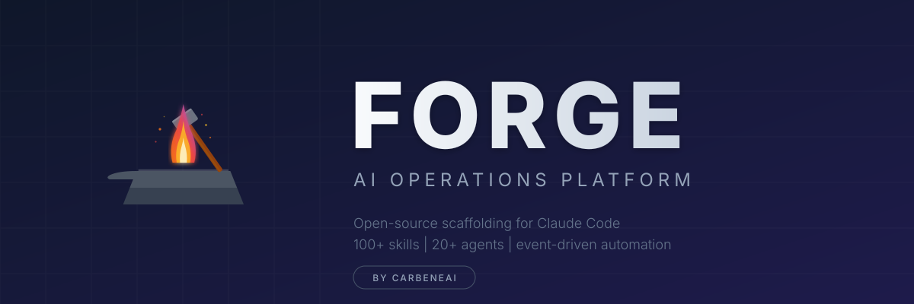

<div align="center">

<picture>
  <source media="(prefers-color-scheme: dark)" srcset="./forge-banner.svg">
  <source media="(prefers-color-scheme: light)" srcset="./forge-banner.svg">
  
</picture>

<br/>

### Open-source AI operations platform built on Claude Code

[](https://github.com/CarbeneAI/Forge/releases)
[](LICENSE)
[](https://claude.ai/code)
[]()


<br/>

[**Quick Start**](#-quick-start) · [**Skills**](#-skills) · [**Agents**](#-agents) · [**Architecture**](#-architecture) · [**Documentation**](#-documentation)

</div>

---

## About CarbeneAI

Forge is one of four open-source proofs of concept published by CarbeneAI, alongside [Harbinger](https://github.com/CarbeneAI/Harbinger) (AI threat intel), [Specter](https://github.com/CarbeneAI/Specter) (AI-assisted SIEM), and [Talon](https://github.com/CarbeneAI/Talon) (AI-assisted offensive workflows). They are not the product. They exist so prospects can see CarbeneAI's founder, Clint P. Garrison, understands the end-to-end strategy of running an AI operations team across security, engineering, and ops infrastructure.

CarbeneAI is a Fractional CTO + CISO + AI Strategy advisory practice for CEOs and Boards in risk-driven environments. Clint owns the strategy and risk seat at the client table; CarbeneAI's team and partner network deliver execution.

Use this repo. Fork it. Improve it. For CarbeneAI advisory engagement: [carbene.ai](https://carbene.ai)

---

## What is Forge?

Forge is an open-source scaffolding system that transforms [Claude Code](https://claude.ai/code) into a personalized AI operations platform. It provides skills-based architecture, specialized agent personalities, event-driven automation, and automatic work capture — turning a generic AI assistant into one that knows your projects, preferences, and workflows.

```
You <-> Claude Code <-> Forge Configuration <-> Claude AI
        (CLI Tool)      (Your Context)          (AI Model)
```

**Without Forge:** Generic Claude with no memory of your stack, projects, or preferences.
**With Forge:** An AI assistant that knows your infrastructure, activates domain-specific skills on demand, delegates to specialized agents, and captures everything for future sessions.

| Component | What It Does |
|-----------|-------------|
| **Skills** | Self-contained AI capabilities with automatic trigger routing (138 included) |
| **Agents** | Specialized AI personalities — architect, engineer, security auditor, researcher |
| **Hooks** | Event-driven TypeScript automation (session start/end, tool use, context compression) |
| **History** | Automatic documentation system that captures sessions, learnings, and research |

---

## Why Forge?

Most AI coding tools give you autocomplete. Forge gives you an **AI operations team** — with memory, security gates, parallel research, and a development workflow that catches vulnerabilities before they ship.

### Persistent Memory Across Sessions

Forge remembers your projects, preferences, decisions, and context between conversations. No more re-explaining your stack, your architecture choices, or your coding style every session. Semantic memory with temporal knowledge graphs means Forge gets smarter the more you use it. Works on macOS and Linux with cross-platform SQLite (better-sqlite3 + sqlite-vec for vector search).

### Multi-Source Research in Parallel

Launch research across 5+ AI models simultaneously — Claude, Gemini, Perplexity, Grok, and local Ollama. Each brings different strengths. Results are synthesized into a single, comprehensive analysis. One prompt, five perspectives.

### 138 Skills with Auto-Activation

Say "research VitePress alternatives" and the Research skill activates automatically. Say "create a CLI tool" and CreateCLI takes over. No slash commands to memorize — skills route based on natural language triggers. Categories span security, AI red-teaming, compliance (15 GRC frameworks), development, business advisory, document processing, QA, and more.

### 20+ Specialized Agents

Not generic "assistants" — purpose-built agent personalities with distinct expertise. A software architect (Bezalel) who writes PRDs. A security auditor (Nehemiah) who reviews every PR for OWASP compliance. A penetration tester (Ehud). An incident responder (Gideon). Each agent knows its domain deeply.

### Real-Time Observability

Live WebSocket dashboard showing agent activity, tool invocations, and event timelines as they happen. Swim lane visualization for multi-agent orchestration. Know exactly what your AI is doing, when, and why.

### Privacy-First Local Routing

Route sensitive prompts to your local Ollama instance — data never leaves your machine. Suitable for HIPAA, PCI, and client-confidential work. One command: `/private`.

### Automatic Work Capture

Every session, every learning, every research output is automatically documented and organized by date. Search across months of AI-assisted work instantly. Nothing is lost.

---

## Security Built In, Not Bolted On

Most AI tools treat security as an afterthought — a linter you run after the code is written, a review you do when you remember. Forge embeds security into every stage of the development lifecycle.

### Mandatory Security Gates

Every code change passes through **Nehemiah** (security auditor agent) before it ships. This isn't optional. OWASP Top 10 compliance checking, SAST analysis, authentication flow review, and dependency vulnerability scanning happen automatically as part of the DevTeam workflow.

### Compliance Agents on Demand

**Daniel** (Chief Compliance Officer) covers **15 GRC frameworks** out of the box: ISO 27001, SOC 2, FedRAMP, GDPR, HIPAA, NIST CSF, PCI DSS, TSA Cybersecurity, ISO 27701, ISO 42001, DORA, DPDPA (India), CMMC 2.0, NIST AI RMF, and SWIFT CSP. Need to verify your application meets regulatory requirements? Ask Daniel — he invokes the matching framework skill and produces audit-grade findings benchmarked at 95% accuracy against the source standards.

### AI Red-Teaming Built In

**PyRIT skill** (Microsoft's open-source Python Risk Identification Tool) ships pre-wired into Forge for jailbreak testing, prompt injection scans, multi-turn attacks (Crescendo, TAP, Skeleton Key), and content-harm scoring against any LLM target — Claude, OpenAI, Azure, HuggingFace, Ollama. Used both offensively (Ehud's red-team engagements) and defensively (Daniel's NIST AI RMF MEASURE / ISO 42001 testing evidence).

### Offensive Security Testing

**Ehud** (penetration tester) runs authorized security assessments against your applications. Combined with the **OSINT**, **RedTeam**, **pentest-workflow**, and **CybersecurityPlaybooks** skills (24 ATT&CK-mapped offensive playbooks covering Kerberoasting, BloodHound, Sliver C2, AD Certificate abuse, Zerologon, DCSync, and more), Forge provides offensive security capabilities typically reserved for dedicated security teams.

### Incident Response

When production breaks, **Gideon** (incident responder) activates — crisis management, rapid debugging, root cause analysis, and post-mortem documentation. Integrated with the **WazuhDashboard** skill for real-time SIEM alert monitoring and triage.

### Privacy by Design

The **Private** skill routes sensitive queries to local models (Ollama/Gemma4) that run on your hardware. Client data, financial projections, medical records — nothing touches external APIs. Combined with the two-repository pattern (private config vs. public code), secrets never leak.

### Protected File System

Critical configuration files are tracked in `.pai-protected.json` with automated validation. API keys live in `.env` (always gitignored). Every `git push` is preceded by sensitive data checks. The system is designed to make accidental exposure difficult.

### Security Skill Arsenal

| Skill | Purpose |
|-------|---------|
| **OSINT** | Open-source intelligence gathering |
| **RedTeam** | Adversarial analysis and attack simulation |
| **pentest-workflow** | Structured penetration testing methodology |
| **Ffuf** | Web fuzzing and directory discovery |
| **Naabu** | Port scanning and service detection (ProjectDiscovery wrapper) |
| **WazuhDashboard** | Real-time SIEM monitoring and alert triage |
| **CSO** | Chief Security Officer strategic review |
| **CybersecurityPlaybooks** | 24 ATT&CK-mapped offensive security playbooks — Kerberoasting, BloodHound, Sliver C2, Zerologon, DCSync, sqlmap, Nmap, Metasploit, and more |
| **PyRIT** | AI/LLM red-teaming — jailbreaks, prompt injection, Crescendo, TAP, Skeleton Key (Microsoft AI Red Team) |
| **PAIAudit** | Audits your own Forge config — settings, MCP servers, hooks, skill supply chain drift |

### Compliance Skill Arsenal — 15 GRC Frameworks

Daniel (CCO agent) maps every client request to the matching framework skill. Each carries article-cited guidance benchmarked at 95% accuracy against source standards.

| Framework | Skill | Coverage |
|-----------|-------|----------|
| **ISO 27001** | `ISO27001` | ISMS, Annex A controls, Statement of Applicability, certification readiness |
| **SOC 2** | `SOC2` | All five Trust Services Criteria (Security, Availability, Confidentiality, Processing Integrity, Privacy) |
| **FedRAMP** | `FedRAMP` | Authority to Operate (ATO), NIST SP 800-53 controls, federal cloud security |
| **GDPR** | `GDPRCompliance` | Privacy policies, DPAs, ROPAs, DSARs, breach notification, code audits |
| **HIPAA** | `HIPAACompliance` | PHI/ePHI, covered entities, BAAs, healthcare-specific controls |
| **NIST CSF** | `NISTCSF` | CSF 2.0 — Govern, Identify, Protect, Detect, Respond, Recover functions |
| **PCI DSS** | `PCICompliance` | v4.0.1 CDE scoping, SAQ selection, QSA audit prep |
| **TSA Cybersecurity** | `TSACompliance` | Pipeline/rail/transit Security Directives, CIP/COIP, ADR/CAP |
| **ISO 27701** | `ISO27701` | Privacy Information Management System (PIMS) extension to ISO 27001 |
| **ISO 42001** | `ISO42001` | AI Management System, AISIA (AI System Impact Assessment), responsible AI |
| **DORA** | `DORA` | EU Digital Operational Resilience Act — ICT risk, TLPT, third-party register |
| **DPDPA** | `DPDPA` | India Digital Personal Data Protection Act, 2023 — Data Fiduciary obligations |
| **CMMC 2.0** | `CMMC` | DoD Cybersecurity Maturity Model — Levels 1/2/3, SSP, POA&M, SPRS scoring |
| **NIST AI RMF** | `NISTAIRMF` | AI Risk Management — GOVERN, MAP, MEASURE, MANAGE functions |
| **SWIFT CSP** | `SWIFTCSP` | Customer Security Programme CSCF v2025 — mandatory + advisory controls |

### Security Agent Roster

| Agent | Role | Why It Matters |
|-------|------|----------------|
| **Nehemiah** | Security auditor | Catches OWASP vulnerabilities before they ship |
| **Daniel** | Chief Compliance Officer | 15 GRC frameworks — ISO 27001, SOC 2, FedRAMP, GDPR, HIPAA, NIST CSF, PCI DSS, TSA, ISO 27701, ISO 42001, DORA, DPDPA, CMMC, NIST AI RMF, SWIFT CSP |
| **Ehud** | Penetration tester | Finds what scanners miss — including AI red-teaming via PyRIT |
| **Gideon** | Incident responder | Minimizes blast radius when things break |

> **The difference:** Other AI tools help you write code faster. Forge helps you write code that's **secure by default** — with the same depth of security review that enterprises pay six figures for, built into your personal development workflow.

---

## Quick Start

### Linux / macOS

```bash
git clone https://github.com/CarbeneAI/Forge.git ~/Forge
bash ~/Forge/scripts/setup-new-machine.sh
```

The installer resolves the checkout from its own location, so another directory works too:

```bash
forge_checkout="$HOME/projects/Forge checkout"
git clone https://github.com/CarbeneAI/Forge.git "$forge_checkout"
bash "$forge_checkout/scripts/setup-new-machine.sh"
```

Install and authenticate Claude Code separately before starting `claude`.

### Windows (WSL)

Run the Linux instructions inside WSL Ubuntu. The installer is a Bash script; run it in the Linux shell rather than PowerShell.

If WSL is not installed, run this in PowerShell as Administrator:

```powershell
wsl --install -d Ubuntu
```

Restart if prompted, open Ubuntu, and create your Linux user. Clone Forge into that user's Linux home and run the installer there.

### Post-Install (all platforms)

The setup script will:

- Check that the checkout contains `.claude` before changing your home configuration.
- Link `~/.claude` to the checkout's `.claude`, backing up an existing directory as `~/.claude.backup.<timestamp>`.
- Install Bun if it is missing.
- Use Bun to update an existing `env.PAI_DIR` string in `settings.json` to `~/.claude`'s absolute path.
- Add a source line for `scripts/pai-aliases.sh` to `.zshrc` if present, otherwise `.bashrc`.
- Create `.env` from its template if no `.env` exists, and create local history directories.
- Create a PyRIT virtual environment if its skill is present and `uv` or Python 3.13 is available.

Rerunning preserves an existing `.env`, reuses the configured symlink, and avoids adding a duplicate alias source line. Existing lines mentioning `pai-aliases.sh` are kept; update that line manually if you move the checkout. `FORGE_REPO_DIR` identifies the checkout for shell helpers, while `PAI_DIR` remains the runtime configuration path at `~/.claude`.

`settings.json` is machine-local and absent from a fresh clone. The installer warns when it is missing and does not create settings or register hooks. Review and migrate your previous settings from the reported backup, or configure Claude Code separately.

The JSON helper handles compact and multiline settings, preserves unrelated parsed values, and changes only `env.PAI_DIR`. It rejects invalid JSON, invalid field types, unsafe integers, and symlink/nonregular settings files without rewriting them. A changed file is formatted as two-space JSON and atomically replaced with its original POSIX permissions. Missing optional entries and already-correct settings remain unchanged. The installer stops if the helper fails. Do not edit settings concurrently with setup; earlier symlink, environment-file, or dependency steps are not rolled back. See [Quick Start](docs/QUICKSTART.md#configure-machine-local-settings) for details.

The installer does not install Claude Code, Node.js, or SemanticMemory's native SQLite dependencies. Follow individual skill requirements before using those features. See the [Quick Start guide](docs/QUICKSTART.md) for setup checks and troubleshooting.

**Add API keys (optional):**

```bash
nano "$HOME/.claude/.env"
```

```bash
GOOGLE_API_KEY=your_key          # Gemini research
PERPLEXITY_API_KEY=your_key      # Perplexity research
```

**Start:**

```bash
source ~/.bashrc  # or ~/.zshrc on macOS
claude
```

**Verify:**

```bash
pai-check    # Read-only setup checks; nonzero when a required check fails
pai-test     # Optional broader diagnostic; also probes a local voice service
```

---

## Shell Commands

| Command | Description |
|---------|-------------|
| `pai` | Go to Forge directory |
| `pai-status` | Git status |
| `pai-pull` | Pull latest from GitHub |
| `pai-push` | Commit and push all changes |
| `pai-sync` | Pull, then commit and push local changes if present |
| `pai-check` | Check setup and return nonzero on required failures |
| `pai-test` | Optional broader runtime diagnostic |
| `pai-skills` | List all skills |
| `pai-agents` | List all agents |
| `pai-new-skill <name>` | Create new skill from template |

`pai-check` checks the checkout, configuration directory, runtime symlink, Git
status, and Bun command. It returns nonzero for missing required paths, a broken
or foreign symlink, failed Git status, or a missing/failing Bun executable while
preserving the caller's directory. A regular `~/.claude` directory and a missing
optional `.env` produce warnings. It neither loads credentials nor validates
settings, hook registration, or service health. Git's optional index refresh and
configured fsmonitor hook are disabled for this diagnostic.

`pai-sync` and `pai-edit` stop when the checkout, editor, or a Git operation
fails and return that failure status. They preserve the caller's working
directory. A failed commit or push can leave staged or committed local changes;
review `git status` before retrying. The [offline checks](docs/QUICKSTART.md#for-contributors-and-coding-agents)
exercise failure paths with fake Git and editor commands.

---

## Skills

Skills are self-contained AI capability packages that activate automatically based on trigger words in your requests. Each skill contains routing logic, workflows, reference docs, and CLI tools.

### Included Skills (120)

| Category | Skills |
|----------|--------|
| **Core** | CORE (identity/config), Fabric (248 AI patterns), Research (multi-source), Observability (real-time dashboard) |
| **Privacy** | Private (route to local Ollama/Gemma4), OllamaResearcher (local AI research) |
| **Security** | OSINT, RedTeam, pentest-workflow, Ffuf, Naabu, WazuhDashboard, CSO, CybersecurityPlaybooks (24 ATT&CK-mapped offensive playbooks), PAIAudit |
| **AI Red-Team** | PyRIT (Microsoft Python Risk Identification Tool — jailbreaks, prompt injection, Crescendo/TAP/Skeleton Key, content-harm scoring) |
| **Compliance** | ISO27001, SOC2, FedRAMP, GDPRCompliance, HIPAACompliance, NISTCSF, PCICompliance, TSACompliance, ISO27701, ISO42001, DPDPA, DORA, CMMC, NISTAIRMF, SWIFTCSP — 15 frameworks at 95% accuracy |
| **Development** | DevTeam (multi-agent dev), CodingAgent, CreateCLI, test-driven-development |
| **Web** | BrightData (4-tier scraping), browse (headless Playwright), connect-chrome |
| **Business** | ceo-advisor, cto-advisor, cfo-advisor, AlexHormoziPitch, pricing, mvp, validate-idea |
| **Content** | Art, ArtGenerator, Prompting, StoryExplanation, CallIntelligence |
| **Documents** | pdf-processing-pro, xlsx, MarkItDown, Obsidian |
| **Operations** | Trading, EmailManager, TelegramBot, TelegramStatus, DiscordAdmin |
| **Workflow** | WritingPlans, ExecutingPlans, WorkflowOrchestration, Algorithm, Governance |
| **QA & Review** | qa, qa-only, review, benchmark, design-review, PeerScan, ReviewBrief |
| **Obsidian & Wiki** | wiki, wiki-ingest, wiki-query, wiki-lint, autoresearch, canvas, defuddle, save, obsidian-bases, obsidian-markdown |

### Creating Your Own

```bash
pai-new-skill MySkill
# Or: "Create a new skill for [purpose]"
```

Every skill follows this structure:

```
skills/SkillName/
├── SKILL.md              # Definition with YAML frontmatter and USE WHEN triggers
├── workflows/            # Step-by-step procedures (TitleCase.md)
├── reference/            # Deep-dive documentation (TitleCase.md)
└── tools/                # CLI utilities (TitleCase.ts)
```

### Skill Activation

Skills activate via natural language — no slash commands needed:

```
You: "Research VitePress alternatives"
-> Research skill activates -> launches parallel agents -> synthesizes findings

You: "Create a CLI tool for managing posts"
-> CreateCLI skill activates -> generates TypeScript CLI with tests
```

---

## Agents

Forge uses specialized agent personalities for different tasks. Agents are invoked via Claude Code's task system and configured in `.claude/agents/`.

### Agent Roster

| Agent | Role | Model |
|-------|------|-------|
| **Bezalel** | Software architecture, PRDs, system design | sonnet |
| **Hiram** | Software engineering, code implementation | sonnet |
| **Miriam** | UI/UX design, visual design, prototyping | sonnet |
| **Solomon** | Principal engineer guidance, code reviews | sonnet |
| **Deborah** | Critical thinking, assumption challenging | sonnet |
| **Nehemiah** | Security auditing, OWASP compliance | opus |
| **Daniel** | Compliance (SOX, GDPR, HIPAA, PCI-DSS) | opus |
| **Gideon** | Incident response, crisis management | opus |
| **Ehud** | Penetration testing, security assessments | sonnet |
| **Phoebe** | CMO — content marketing, brand strategy | sonnet |
| **Aquila** | VP Sales — pipeline, CRM, outreach | sonnet |
| **Jethro** | COO — operations, service delivery | sonnet |
| **Joshua** | Project manager — task boards, coordination | sonnet |
| **Ezra** | QA engineer — test suites, validation | sonnet |
| **Silas** | Video content producer | sonnet |

Research agents connect to external AI APIs: Claude, Gemini, Perplexity, Grok, and local Ollama.

### When to Use Which Agent

| Task | Agent |
|------|-------|
| Design a system | Bezalel |
| Write code | Hiram |
| Design UI | Miriam |
| Code review | Solomon |
| Challenge assumptions | Deborah |
| Security audit | Nehemiah |
| Pentest | Ehud |
| Production incident | Gideon |

---

## Architecture

### The Thirteen Founding Principles

Forge is built on 13 foundational principles:

1. **Clear Thinking + Prompting is King** — Quality thinking before code
2. **Scaffolding > Model** — System architecture matters more than the AI model
3. **As Deterministic as Possible** — Same input, same output
4. **Code Before Prompts** — Write code, use prompts to orchestrate
5. **Spec / Test / Evals First** — Define behavior before implementation
6. **UNIX Philosophy** — Do one thing well, compose through interfaces
7. **ENG / SRE Principles** — Treat AI infrastructure as infrastructure
8. **CLI as Interface** — Every operation accessible via command line
9. **Goal -> Code -> CLI -> Prompts -> Agents** — Proper development pipeline
10. **Meta / Self Update System** — System can improve itself
11. **Custom Skill Management** — Skills as organizational units for domain expertise
12. **Custom History System** — Automatic capture and preservation
13. **Custom Agent Personalities** — Specialized agents for different tasks

Full philosophy: [`.claude/skills/CORE/CONSTITUTION.md`](.claude/skills/CORE/CONSTITUTION.md)

### Directory Structure

```
~/Forge/
├── .claude/
│   ├── settings.json          # Machine-local configuration (not supplied)
│   ├── .env                   # API keys (never committed)
│   ├── mcp.json               # MCP server configuration
│   ├── hooks/                 # Event-driven automation (TypeScript)
│   │   ├── initialize-session.ts
│   │   ├── capture-all-events.ts
│   │   ├── capture-tool-output.ts
│   │   ├── stop-hook.ts
│   │   └── lib/pai-paths.ts   # Centralized path resolution
│   ├── skills/                # 120 domain-specific capabilities
│   │   ├── CORE/              # Identity, architecture, principles
│   │   ├── Fabric/            # 248 native AI patterns
│   │   ├── Research/          # Multi-source research workflows
│   │   ├── Private/           # Local Ollama privacy routing
│   │   ├── Observability/     # Real-time agent monitoring dashboard
│   │   └── [90+ more]/
│   ├── agents/                # Specialized agent configs
│   ├── history/               # Automatic work capture (UOCS)
│   └── tools/                 # System utilities
├── scripts/
│   ├── setup-new-machine.sh   # Initial setup
│   └── pai-aliases.sh         # Shell aliases
├── docs/                      # Guides and references
└── README.md
```

### Hooks

Event-driven TypeScript automation executed via Bun:

| Hook | Event | Purpose |
|------|-------|---------|
| `initialize-session.ts` | SessionStart | Load context and environment |
| `load-core-context.ts` | SessionStart | Auto-load CORE skill |
| `capture-all-events.ts` | PreToolUse | Log tool invocations |
| `capture-tool-output.ts` | PostToolUse | Capture tool results |
| `capture-session-summary.ts` | SessionEnd | Preserve session learnings |
| `stop-hook.ts` | Stop | Capture context on stop |
| `context-compression-hook.ts` | PreCompact | Manage context compression |

### History System (UOCS)

Automatic capture preserves all work:

```
history/
├── sessions/          # Session summaries (YYYY-MM/)
├── learnings/         # Problem-solving narratives (YYYY-MM/)
├── research/          # Analysis outputs (YYYY-MM/)
└── raw-outputs/       # Event logs (YYYY-MM/)
```

### Privacy Mode

Route sensitive queries to your local Ollama server — data never leaves your machine:

```
/private Analyze these financial projections for Client X
```

Uses Gemma4 31B (or any model on your Ollama instance) via `localhost:11434`. Suitable for HIPAA/PCI-sensitive data.

---

## Multi-Machine Sync

Forge syncs across machines via Git:

```
┌──────────────────────────────────────────┐
│           GitHub (Private Repo)           │
└──────────────────────────────────────────┘
                    │
         ┌──────────┼──────────┐
         v          v          v
    ┌────────┐ ┌────────┐ ┌────────┐
    │ Linux  │ │  Mac   │ │ Laptop │
    │ Server │ │ Studio │ │        │
    └────────┘ └────────┘ └────────┘
```

```bash
# On any new machine
git clone https://github.com/CarbeneAI/Forge.git ~/Forge
bash ~/Forge/scripts/setup-new-machine.sh

# Daily workflow
pai-pull   # Get latest
pai-push   # Save changes
```

> **Note:** `PAI_DIR` in machine-local `settings.json` is machine-specific. The setup script updates it only when that file and entry already exist.

---

## Technology Stack

| Category | Choice |
|----------|--------|
| **Runtime** | Bun (hooks, tools) + Node.js/tsx (SemanticMemory) |
| **Language** | TypeScript |
| **Package Manager** | Bun |
| **AI Platform** | Claude Code |
| **Format** | Markdown |

> **Why two runtimes?** Most Forge tools run on Bun for speed. SemanticMemory uses `better-sqlite3` (via `npx tsx`) because Bun's built-in SQLite cannot load native extensions (like sqlite-vec) on macOS. This ensures Forge works identically on macOS, Linux, and WSL.

---

## Documentation

See the [proposed contributor roadmap](ROADMAP.md) for setup reliability priorities and acceptance criteria for maintainer discussion.

All core docs live in `.claude/skills/CORE/`:

| Document | Description |
|----------|-------------|
| [**CONSTITUTION.md**](.claude/skills/CORE/CONSTITUTION.md) | System philosophy and 13 founding principles |
| [**SkillSystem.md**](.claude/skills/CORE/SkillSystem.md) | How to create your own skills |
| [**SKILL.md**](.claude/skills/CORE/SKILL.md) | Main configuration and identity |
| [**HookSystem.md**](.claude/skills/CORE/HookSystem.md) | Event-driven automation |
| [**HistorySystem.md**](.claude/skills/CORE/HistorySystem.md) | Automatic work documentation |

---

## Configuration

### Environment Variables (settings.json)

`~/.claude/settings.json` is gitignored and not included in a fresh clone. Review or configure your local settings separately, including any hooks and permissions you need. The installer only updates an existing `env.PAI_DIR` string through its JSON settings helper. This example shows environment values, not a complete hook configuration:

```json
{
  "env": {
    "PAI_DIR": "/home/you/.claude",
    "DA": "Forge",
    "CLAUDE_CODE_MAX_OUTPUT_TOKENS": "64000"
  }
}
```

### API Keys (.env)

All API keys go in `~/.claude/.env` (gitignored). Setup creates a missing file from `.env.example`, or a minimal template, with owner-only read and write permissions even under a permissive shell umask. Keep credentials out of commits.

Existing regular files keep their contents and permissions. Check an existing `.env` before adding credentials; use `chmod 600 ~/.claude/.env` when it should be private. Setup rejects symlink and non-regular `.env` destinations instead of following or replacing them. Private temporary names are ignored as well, including leftovers from an interrupted setup.

**Claude Code authentication:**
Authenticate Claude Code separately. The keys below enable optional integrations.

**Research APIs:**

| Variable | Service | Used By | Free Tier? |
|----------|---------|---------|------------|
| `GOOGLE_API_KEY` | Google Gemini | Research, GeminiResearcher agent | Yes |
| `PERPLEXITY_API_KEY` | Perplexity AI | Research, PerplexityResearcher agent | No |
| `XAI_API_KEY` | xAI Grok | GrokResearcher agent | Yes |
| `OPENAI_API_KEY` | OpenAI (GPT, DALL-E, embeddings) | SemanticMemory, ArtGenerator | No |

**Communication:**

| Variable | Service | Used By | Free Tier? |
|----------|---------|---------|------------|
| `TELEGRAM_BOT_TOKEN` | Telegram Bot API | TelegramBot, TelegramStatus, notifications | Yes |
| `TELEGRAM_CHAT_ID` | Telegram | Notification target | Yes |
| `DISCORD_BOT_TOKEN` | Discord Bot API | DiscordAdmin skill | Yes |
| `DISCORD_GUILD_ID` | Discord | Server target | Yes |

**Trading (Joseph agent):**

| Variable | Service | Used By | Free Tier? |
|----------|---------|---------|------------|
| `ALPACA_API_KEY` | Alpaca Markets | Trading skill (paper/live) | Yes (paper) |
| `ALPACA_API_SECRET` | Alpaca Markets | Trading skill | Yes (paper) |

**Web Scraping & Content:**

| Variable | Service | Used By | Free Tier? |
|----------|---------|---------|------------|
| `BRIGHTDATA_API_TOKEN` | Bright Data | BrightData skill (Tier 4 scraping) | No |
| `REPLICATE_API_TOKEN` | Replicate | ArtGenerator (Flux, Stable Diffusion) | Limited |

**Infrastructure (self-hosted):**

| Variable | Service | Used By | Notes |
|----------|---------|---------|-------|
| `OLLAMA_URL` | Ollama | Private, OllamaResearcher | Default: `http://localhost:11434` |
| `OLLAMA_MODEL` | Ollama | Private, OllamaResearcher | Default: `gemma4:31b` |
| `N8N_API_URL` | n8n | Workflow automation (MCP) | Self-hosted |
| `N8N_API_KEY` | n8n | Workflow automation (MCP) | Self-hosted |

> **Security:** Never commit `.env` files. The `.gitignore` is pre-configured to exclude them. Run `git status` before pushing to verify.

---

## Origins & Acknowledgments

Forge started as a fork of [**Daniel Miessler's Personal AI Infrastructure (PAI)**](https://github.com/danielmiessler/Personal_AI_Infrastructure) — the original open-source vision for giving individuals the same AI scaffolding that companies spend millions building. Dan's core insight — that the best AI should be available to everyone, not locked inside corporations — is the foundation everything here is built on.

If you haven't read Dan's [**The Real Internet of Things**](https://danielmiessler.com/blog/real-internet-of-things), start there. It's the "why" behind this entire project. His 13 founding principles, skills-as-containers architecture, and CLI-first philosophy remain at the heart of Forge.

Dan is also the creator of [**Fabric**](https://github.com/danielmiessler/fabric) — the AI pattern framework with 248+ patterns that ships natively inside Forge. His work on making AI practical and accessible has shaped how thousands of people think about personal AI systems.

[**Jason Haddix**](https://www.bughuntermethodology.com/) is the other half of the lineage. His **Bug Hunter Methodology** is the offensive-security playbook that shaped how Forge's pentest-workflow, the CybersecurityPlaybooks skill (24 ATT&CK-mapped playbooks), and the companion Talon project think about reconnaissance, enumeration, and attack-path mapping. If Dan gave Forge its skeleton, Jason gave it its teeth. The modern offensive-security craft owes him a real debt — read the methodology, watch his talks, follow his work.

**What Forge adds on top of PAI:**
- 138 skills (up from ~10) including 24 ATT&CK-mapped offensive security playbooks, 15 GRC compliance frameworks, AI red-teaming via PyRIT, and 20+ specialized agents with distinct personalities
- Security-first development with mandatory audit gates (OWASP, SAST)
- AI red-teaming pre-wired (Microsoft PyRIT) for jailbreak/prompt-injection testing of any LLM target
- Compliance coverage at 95% accuracy across ISO 27001, SOC 2, FedRAMP, GDPR, HIPAA, NIST CSF, PCI DSS, TSA, ISO 27701, ISO 42001, DORA, DPDPA, CMMC 2.0, NIST AI RMF, SWIFT CSP
- Real-time observability dashboard with WebSocket streaming
- Privacy routing to local models (Ollama/Gemma4) for sensitive data
- Multi-agent orchestration with parallel execution
- Semantic memory with temporal knowledge graphs
- C-suite advisory agents (CTO, CFO, CEO, COO, CMO, CISO)

Built and maintained by [CarbeneAI](https://carbene.ai). Standing on the shoulders of Dan's vision and Jason's methodology.

---

## License

MIT License — see [`LICENSE`](LICENSE) for details.

---

<div align="center">

**Your AI. Your rules. Your infrastructure.**

Built on [Claude Code](https://claude.ai/code) by Anthropic.

</div>
